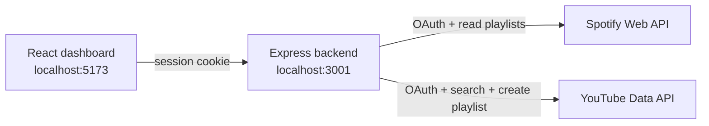

# SyncTune

SyncTune moves a music playlist from Spotify to YouTube. You sign in to both services, pick a playlist, and SyncTune searches YouTube for each song, shows you how confident each match is, and then builds a private YouTube playlist from the matches you approve.

It is a full-stack TypeScript/JavaScript project: a React dashboard talks to a small Express backend, and the backend handles all OAuth sign-ins and API calls so that no secrets or tokens ever reach the browser.

## Contents

- [Features](#features)
- [Screenshots](#screenshots)
- [Tech stack](#tech-stack)
- [How it works](#how-it-works)
- [Getting started](#getting-started)
- [Environment variables](#environment-variables)
- [API and integrations](#api-and-integrations)
- [Project structure](#project-structure)
- [Current limitations](#current-limitations)
- [Future improvements](#future-improvements)
- [Contributing](#contributing)
- [License](#license)

## Features

### Working now

- **Spotify playlist import.** Sign in with Spotify, pick one of your playlists (or paste its link), and SyncTune loads every song's title, artists, album and length. Podcast episodes and songs Spotify no longer provides are skipped and counted.
- **Paste a track list.** No Spotify account needed: paste songs one per line as `Artist - Title`, or copy Title and Artist columns from a spreadsheet.
- **YouTube song matching.** Each song is searched on YouTube and the top results are scored on title, artist, official channels ("Artist - Topic", VEVO) and song length. Live versions, covers and remixes are penalised unless the original track is one. Every song is labelled **Matched**, **Needs review** or **Not found**, with a link to the chosen video.
- **Review before anything is created.** Searching never changes your YouTube account. A private playlist is only created when you click **Create playlist**, and you choose whether to include the "Needs review" songs.
- **Safe retries.** If adding songs fails partway (for example, the daily YouTube quota runs out), the songs already added are kept and **Retry** continues in the same playlist instead of creating a duplicate. Brief YouTube errors are retried automatically.
- **Progress and results.** A live progress bar, per-song results with filters, and a summary of what was added and what couldn't be matched.
- **Quota-friendly.** Search results are cached while the server runs, so matching the same songs again costs no YouTube quota.
- **Demo mode.** A built-in demo playlist (made-up songs, simulated matching) shows the whole flow without signing in to anything.
- **YouTube connection test.** A small panel checks the YouTube connection and can create a private test playlist.
- **History.** Every real (non-demo) transfer is saved in your browser with its per-song results and a link to its YouTube playlist. The sidebar's **Recent transfers** shows the latest three.
- **Match cache page.** See the YouTube results the server has cached for songs you matched, search and filter them, and forget one (or all) so it's searched again next time.
- **Settings.** Connection status for Spotify and YouTube, a starting track limit and whether to add "Needs review" songs by default (saved in your browser), and controls for the saved data.
- **Pages with real URLs.** `/`, `/history`, `/match-cache` and `/settings` work with the browser's back and forward buttons and can be bookmarked. A transfer keeps running while you look at another page.

## Screenshots

> Screenshots coming soon.

<!--
Add images to a folder such as docs/screenshots/ and reference them here, for example:


-->

## Tech stack

| Area | Technologies |
| --- | --- |
| Frontend | [React 19](https://react.dev), [TypeScript](https://www.typescriptlang.org), [Vite](https://vite.dev), plain CSS |
| Backend | [Node.js](https://nodejs.org), [Express 5](https://expressjs.com), [express-session](https://github.com/expressjs/session), [cors](https://github.com/expressjs/cors), [dotenv](https://github.com/motdotla/dotenv) |
| APIs | [YouTube Data API v3](https://developers.google.com/youtube/v3) via [googleapis](https://github.com/googleapis/google-api-nodejs-client), [Spotify Web API](https://developer.spotify.com/documentation/web-api) |
| Auth | OAuth 2.0 authorization code flow for Google and Spotify, handled on the server |
| Tooling | ESLint, TypeScript compiler (`tsc -b`) |

## How it works



1. **Load songs** from a Spotify playlist, a pasted list, or the demo.
2. **Find YouTube matches.** The backend searches YouTube for each song (read-only).
3. **Create the playlist.** When you click the button, the backend creates a private YouTube playlist and adds the matched videos in small batches. Each transfer has an ID, so retries reuse the same playlist and skip songs already added.

Tokens are stored in the server-side session only; the browser just holds a session cookie.

## Getting started

### Prerequisites

- **Node.js 22.12 or newer** (required by `googleapis` and Vite) and npm
- A **Google account with a YouTube channel**, plus a Google Cloud project (setup below)
- *Optional:* a **Spotify account** and a Spotify developer app to import Spotify playlists. Spotify requires the app owner to have **Spotify Premium**. Without Spotify, you can still paste track lists.

### 1. Install

```bash
git clone https://github.com/abbas-4/SyncTune.git
cd SyncTune
npm install
cd server
npm install
```

### 2. Set up Google / YouTube

1. In the [Google Cloud Console](https://console.cloud.google.com), create a project.
2. Enable **YouTube Data API v3** (APIs & Services → Library).
3. Configure the **OAuth consent screen**. While the app is in testing, add your own Google account as a **test user**.
4. Create an **OAuth client ID** of type **Web application** and add this **authorized redirect URI**:

   ```text
   http://localhost:3001/oauth2/callback
   ```

5. Copy the client ID and client secret into `server/.env` (next step).

SyncTune requests one scope: `https://www.googleapis.com/auth/youtube`.

### 3. Set up Spotify (optional)

1. In the [Spotify Developer Dashboard](https://developer.spotify.com/dashboard), create an app and select **Web API**.
2. Add this **redirect URI** exactly. Spotify does not accept `localhost`, so it must be `127.0.0.1`:

   ```text
   http://127.0.0.1:3001/auth/spotify/callback
   ```

3. Under **User Management**, add the Spotify account(s) that will sign in (Development Mode allows a small number of users).
4. Copy the client ID and client secret into `server/.env`.

SyncTune requests `playlist-read-private` and `playlist-read-collaborative`. It only reads playlists; it never changes anything on Spotify.

You still open the dashboard at `http://localhost:5173`. After Spotify redirects to `127.0.0.1`, the backend hands the sign-in back to your `localhost` session.

### 4. Create `server/.env`

Create a file named `.env` **inside the `server` folder** (see [Environment variables](#environment-variables)). To generate a random session secret:

```bash
node -e "console.log(require('crypto').randomBytes(32).toString('hex'))"
```

### 5. Run it

Start the backend (from the `server` folder, so it finds `server/.env`):

```bash
cd server
npm start
```

In a second terminal, start the frontend from the project root:

```bash
npm run dev
```

Open **http://localhost:5173**. Use `localhost`, not `127.0.0.1`, for the dashboard: the backend only accepts requests from that address. (If Vite reports a different port because 5173 is busy, free up 5173 and restart it.) You can check the backend at http://localhost:3001/api/health.

Then connect YouTube (and Spotify), load a playlist, click **Find YouTube matches**, review the results, and click **Create playlist**.

### Other scripts

Run these from the project root:

| Command | What it does |
| --- | --- |
| `npm run dev` | Start the Vite dev server on port 5173 |
| `npm run build` | Type-check (`tsc -b`) and build the frontend into `dist/` |
| `npm run preview` | Preview the production build |
| `npm run lint` | Run ESLint |

### Deploying

To host SyncTune (frontend on Vercel, backend on Render), follow [DEPLOYMENT.md](DEPLOYMENT.md). It lists the exact settings, environment variables and OAuth redirect URIs.

## Environment variables

All secrets live in `server/.env`, which is ignored by git. Never put them in the frontend or in a variable that starts with `VITE_`, because Vite includes those in the code sent to the browser.

**`server/.env`** (example values only):

```dotenv
# Google / YouTube (required)
GOOGLE_CLIENT_ID=your-google-client-id.apps.googleusercontent.com
GOOGLE_CLIENT_SECRET=your-google-client-secret

# Signs the session cookie (required). Use a long random string.
SESSION_SECRET=replace-with-a-long-random-string

# Backend port (optional, defaults to 3001)
PORT=3001

# Spotify (optional; leave out to disable Spotify import)
SPOTIFY_CLIENT_ID=your-spotify-client-id
SPOTIFY_CLIENT_SECRET=your-spotify-client-secret
# SPOTIFY_REDIRECT_URI=http://127.0.0.1:3001/auth/spotify/callback
```

| Variable | Required | Notes |
| --- | --- | --- |
| `GOOGLE_CLIENT_ID` | Yes | From your Google OAuth client |
| `GOOGLE_CLIENT_SECRET` | Yes | From your Google OAuth client |
| `SESSION_SECRET` | Yes | Any long random string |
| `PORT` | No | Defaults to `3001`. If you change it, update both redirect URIs to match. |
| `SPOTIFY_CLIENT_ID` | For Spotify | From the Spotify Developer Dashboard |
| `SPOTIFY_CLIENT_SECRET` | For Spotify | From the Spotify Developer Dashboard |
| `SPOTIFY_REDIRECT_URI` | No | Only if you registered a different redirect URI. Defaults to `http://127.0.0.1:<PORT>/auth/spotify/callback`. |
| `FRONTEND_URL` | Production | Where the dashboard runs. Defaults to `http://localhost:5173`. |
| `GOOGLE_REDIRECT_URI` | Production | Defaults to `http://localhost:<PORT>/oauth2/callback`. |
| `NODE_ENV` | Production | Set to `production` when deployed: enables secure cookies and the proxy settings. |
| `TRUST_PROXY` | No | Production only. Number of proxies in front of the server, default `1`. |
| `MATCH_CACHE_SWEEP_MS` | No | How often the server drops match-cache claims held by expired sessions, in milliseconds. Defaults to `600000` (10 minutes). |

The server refuses to start without the three required Google/session variables. Without the Spotify variables it still runs, and the dashboard shows Spotify as "Not set up". Locally you don't need any of the production variables; see [DEPLOYMENT.md](DEPLOYMENT.md) for their deployed values.

**Frontend (optional), `.env.local` in the project root:**

```dotenv
# Only needed if the backend is not at http://localhost:3001
VITE_API_BASE_URL=http://localhost:3001
```

## API and integrations

### YouTube (Google OAuth)

- Authorization code flow on the server, with offline access so tokens can be refreshed.
- Uses YouTube Data API `search.list` and `videos.list` (matching), `playlists.insert` and `playlistItems.insert` (creating the playlist), and `playlistItems.list` (resuming a transfer).
- **Quota:** Google gives each project a daily quota (10,000 units by default). One song search costs about 100 units and adding one song costs 50, so a 20-song transfer uses roughly 3,000 units. Repeat searches are served from the server's cache.

### Spotify

- Authorization code flow with the client secret kept on the server.
- Uses `GET /me`, `GET /me/playlists`, `GET /playlists/{id}` and `GET /playlists/{id}/items`, with automatic token refresh and paging (50 songs per page).
- Read-only: SyncTune never modifies Spotify data.

### Backend routes

| Method | Route | Purpose |
| --- | --- | --- |
| GET | `/api/health` | Health check |
| GET | `/auth/youtube` | Start Google sign-in |
| GET | `/oauth2/callback` | Google OAuth callback |
| GET | `/api/youtube/status` | Is YouTube connected in this session? |
| POST | `/api/youtube/match` | Find the best YouTube video for one song (search only) |
| POST | `/api/youtube/playlists` | Create a private playlist and add videos (retry-safe with a `transferId`) |
| GET | `/api/youtube/match-cache` | Cached matches for songs this session looked up |
| DELETE | `/api/youtube/match-cache/:id` | Forget one cached match |
| DELETE | `/api/youtube/match-cache` | Forget every cached match this session looked up |
| GET | `/auth/spotify` | Start Spotify sign-in |
| GET | `/auth/spotify/callback` | Spotify OAuth callback (on `127.0.0.1`) |
| GET | `/auth/spotify/complete` | Finishes Spotify sign-in back on `localhost` |
| GET | `/api/spotify/status` | Is Spotify set up and connected? |
| GET | `/api/spotify/playlists` | Your Spotify playlists, marked by whether they can be read |
| GET | `/api/spotify/playlists/:id` | One playlist's songs (title, artists, album, length) |

## Project structure

```text
SyncTune/
├── index.html              # Vite entry page
├── package.json            # Frontend scripts and dependencies
├── vite.config.ts
├── eslint.config.js
├── tsconfig*.json
├── public/                 # Static assets (favicon, icons)
├── src/
│   ├── main.tsx            # React entry point
│   ├── App.tsx             # App shell and sidebar; Transfer page (playlist input, track table, transfer panel)
│   ├── HistoryPage.tsx     # Past transfers and their results
│   ├── MatchCachePage.tsx  # View and manage cached YouTube matches
│   ├── SettingsPage.tsx    # Accounts, transfer defaults, saved data
│   ├── router.ts           # Small History-API router for the four pages
│   ├── transferHistory.ts  # Transfer history saved in localStorage
│   ├── settings.ts         # Preferences saved in localStorage
│   ├── App.css             # Dashboard styles
│   ├── index.css           # Global styles and colour tokens
│   ├── YouTubeTestPanel.tsx  # YouTube connection test panel
│   ├── youtubeApi.ts       # Calls to the backend's YouTube routes
│   └── spotifyApi.ts       # Calls to the backend's Spotify routes
├── server/
│   ├── server.js           # Express app: sessions, Google OAuth, YouTube routes
│   ├── spotify.js          # Spotify OAuth and playlist import routes
│   ├── youtubeMatch.js     # Song-to-video scoring (pure functions)
│   └── package.json        # Backend dependencies; `npm start`
├── app.js, styles.css      # Earlier standalone prototype, not used by the React app
└── README.md
```

## Current limitations

- **Spotify only shares songs from your own playlists.** Under Spotify's Development Mode rules, an app can read the songs of playlists you **own or collaborate on**. Playlists by other people return an error, and Spotify-made playlists (Discover Weekly, editorial mixes) can't be read by apps. Workaround: copy the songs into a playlist of your own in Spotify, then import that.
- **Spotify Development Mode limits.** The app owner needs Spotify Premium, and only a few users (added under User Management) can sign in.
- **History stays in one browser.** Transfer history and settings are saved in the browser's localStorage, so they don't follow you to another browser or device.
- **Sessions live in server memory.** Sessions, in-progress transfers and the match cache are lost whenever the backend restarts (locally, or when a free host spins down), which signs everyone out. See [DEPLOYMENT.md](DEPLOYMENT.md#limitations-of-the-free-setup) for the other limits of a free deployment.
- **YouTube quota.** The default daily quota covers only a few transfers of 20 or so songs.
- **Matching isn't perfect.** Songs marked "Needs review" deserve a quick look, and the same video can match two different songs.
- **One direction only.** Transfers go from Spotify (or pasted text) to YouTube.
- **No disconnect button yet.** You can't sign out of Spotify or YouTube from the dashboard; restarting the backend clears the session.
- **No automated test suite** is included in the repository yet.

## Future improvements

These are **planned ideas, not finished features**:

- "Disconnect" buttons for Spotify and YouTube, and links from imported songs back to Spotify
- Let users swap a "Needs review" match for a different search result
- Persistent sessions, match cache and server-side transfer history (database or session store)
- Reopen a past transfer from History to add more songs to its playlist
- Automated tests (unit tests for matching, API tests with mocked Spotify/YouTube) and CI
- More platforms and directions (for example YouTube → Spotify, Apple Music)

## Contributing

This is a personal portfolio project, but suggestions are welcome. Open an issue to report a bug or propose an idea, or open a pull request. Before submitting, please make sure `npm run lint` and `npm run build` pass, and never commit `.env` files or credentials.

## License

This repository does not include a license yet, so standard copyright applies and the code may not be reused without permission. A license may be added later.
